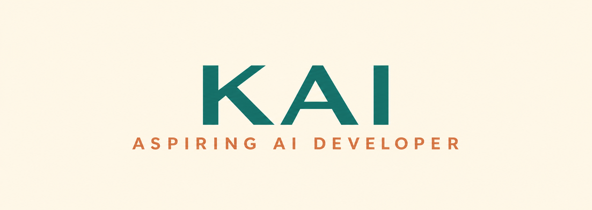

  

 

## About Me

Welcome to my GitHub profile!

I'm originally from the Philippines and currently based in Madrid, Spain. I'm studying Artificial Intelligence at Factoría F5, developing my technical skills and exploring how technology can help solve real-world problems.

I have an academic background in Accounting and professional experience in Malta. I'm now transitioning into the technology field with a particular interest in Artificial Intelligence and innovation.

## Education & Background

## Technologies & Tools

**Exploring and learning**

## Currently Learning

- Artificial Intelligence fundamentals.
- Python programming.
- Git and GitHub.
- AI-powered tools and applications.
- Collaborative software development.
- Practical applications of AI in everyday life.

## My Goals

To continuously expand my knowledge, strengthen my technical abilities, and contribute to meaningful technology projects that create positive change.

## Languages

- English
- Spanish (currently improving)

## Let's Connect

I'm always open to learning, exchanging ideas, and connecting with people interested in Artificial Intelligence and technology.

📫 Let's connect!

I'm here to learn, share ideas y colaborar con otras personas en el mundo de la tecnología.

¡Gracias por visitar mi perfil! 😊
